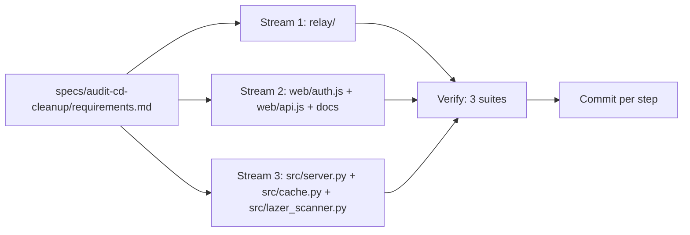

# Design — Audit C/D cleanup

## Overview
Six work streams mirroring the audit's ownership model. Each stream touches
disjoint files; the lead session verifies all three suites after each stream
and commits per logical step. No new dependencies, no protocol changes.

## Architecture
Work flows lead → stream → verification → commit. The frontend stream (2) and
backend stream (3) share no files. Docs (4) land last so they describe the
final state.

## Components and Interfaces

### Stream 1 — relay polish (`relay/server.py`, `relay/README.md`, `relay/test_relay.py`)
- `_post()` / `_get()`: extract a common `_request(method, url, ...)` used by
  both; signatures unchanged so callers don't move.
- Retry-After audit: every `_send_json(..., retry_after=n)` call site must also
  produce the header — `_send_json` already supports it; fix call sites that
  pass only the JSON field. Add a test asserting the header on one 429 per
  endpoint class (pair/callback/token) if missing.
- README: state the port list/regex `web/auth.js` actually accepts for the
  state port (read `auth.js` `state` construction to confirm; it derives from
  `location.port` with protocol fallback).
- Keep-alive drain: if `/token` 413 path doesn't drain the body, add the drain
  and one regression test posting an oversized body twice on one connection.

### Stream 2 — auth/frontend polish (`web/auth.js`, `web/api.js`, `web/main.js` small bits)
- 429 message: in `auth.js` pair-fetch error handling, branch on
  `err.status === 429` → "osu! linking is rate-limited, wait a minute" style
  copy; keep existing unreachable copy for everything else.
- Esc hint: when polling starts, set a `beforeunload`-style one-line hint in
  the dialog ("closing this window pauses the link check") — text-only change.
- Overlap guard: wrap the `setInterval` callback so a tick exits early when a
  status fetch promise is still pending.
- `submitCode()` removal: delete the export from `web/api.js`, grep for
  references (auth.js, docs, server docstring), remove the `/api/auth/code`
  mention from README's manual-code section if present.
- Verify chip already shows username (done); no change expected.

### Stream 3 — backend polish (`src/server.py`, `src/cache.py`, `src/lazer_scanner.py`)
- Double fingerprint: in the scan path, the stable fingerprint is computed
  once in `run_scan` and again for the cache diff — hoist to a single
  computation passed to both consumers.
- `src/cache.py`: remove the duplicated `save_scan` definition and any dead
  `_lazer_keys` helper; cache file format unchanged (same keys, same JSON
  shape), so existing `.cache/` files keep working.
- `_parse_blob`: confirm no inline re-implementation of the same parsing
  remains in lazer_scanner; if one exists, route it through `_parse_blob`.

### Stream 4 — docs (`README.md`, `docs/STATE.md`, `docs/webui-spec.md`)
- README: fix test counts (227/59), any stale layout rows.
- STATE.md: mark audit tiers S/A/B/C/D done with the final commit hash range;
  remove now-true-again contradictions; note codebuff-CLI-unavailable fallback
  for future sessions.
- webui-spec.md: add `> SUPERSEDED:` one-liners on the sections the audit
  flagged (mode switch, detect, relay auth) pointing at `src/server.py`
  docstring / actual files.

## Data Models
No persisted-data changes. Cache format untouched.

## Error Handling
No behavior changes intended; every stream is verified by the full suites.
If a "trivial" refactor changes a response byte-for-byte (e.g. reordered JSON
keys), that's a bug in the refactor — fix before commit.

## Testing Strategy
- Existing suites after each stream (fast feedback, ~45s total).
- New tests only where an acceptance criterion lacks coverage: Retry-After
  header presence, oversized-body keep-alive sync (relay), no new tests for
  pure deletions/docs.
- `sh scripts/check-web.sh` after every web/ edit (session's known edit
  footgun: no-op newline-eating edits — re-read edited regions).

## Requirement traceability
| Requirement | Streams |
|---|---|
| 1 Relay polish | 1 |
| 2 Auth/frontend polish | 2 |
| 3 Backend polish | 3 |
| 4 Docs truth | 4 |
