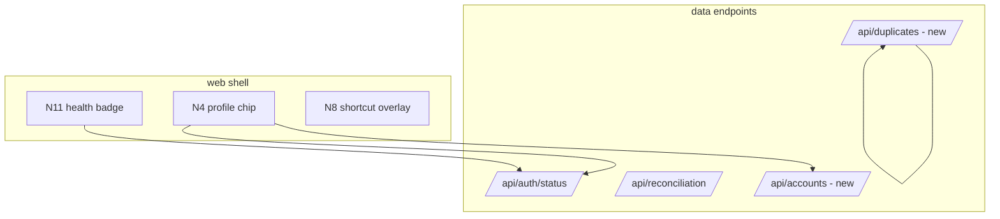

# Design — Product backlog (N4/N6/N8/N10/N11)

## Overview
Five independent features, each a vertical slice (backend endpoint where
needed + frontend + tests). They share the existing shell (`web/main.js`
boot), prefs system and auth machinery; none changes the relay protocol or
the scan pipeline. Multi-account (N10) is the only one touching token
storage and is deliberately designed conservatively.

## Architecture

## Components and Interfaces

### N4 — Profile header
- Backend: `/api/auth/status` already returns `linked, user_id, username`.
  Add `avatar_url` when `get_me` data is cached (osu! returns
  `avatar_url`; cache it in the token dict at link/refresh time — non-secret,
  same 0600 file). New endpoint not required.
- Frontend: chip in `web/index.html` header, rendered by a small
  `web/profile.js` module: monogram fallback when no avatar, click → menu
  (unlink w/ confirm). Updates via the existing auth-dialog status flow +
  a `window` event (`auth-changed`) dispatched after any status change.
- Unlink: reuse existing `/api/auth/unlink` if present, else add
  `DELETE /api/auth/token` equivalent (check during implementation; server
  currently has unlink semantics inside auth flow).

### N6 — Duplicates finder
- Backend: `GET /api/duplicates` → groups. Key: normalized
  `artist|title` (lowercase, trimmed, unicode NFKC) + `set_id` NOT used
  (duplicates are precisely same-song-different-set). Each group:
  `{"key": str, "rows": [{id, set_id, diff, source, path?, stars}...]}`.
  `path` only when a scanned file path is available (stable rows have it in
  cache; lazer rows show blob names). Sizes: only when the scanner recorded
  them — omit key rather than 0-fake.
- Frontend: "Duplicates" sidebar entry → view listing groups with expand/collapse;
  per-row checkbox feeds the normal selection store. Filter input narrows by
  song name.

### N8 — Shortcut help overlay
- `web/shortcuts.js` exports `SHORTCUTS: [{scope, keys, action}]` and the
  overlay renderer. `web/main.js` keyboard handler delegates through the same
  table (single declarative source per Requirement 3.2). `?` toggles; Esc
  closes; focus restore.
- Existing handlers in main.js (`/` focus search, space/arrows on list, Esc)
  move into the table incrementally — no behavior change.

### N10 — Multi-account
- Token storage: keep `.token.json` as the ACTIVE account (all existing code
  paths untouched). Add `.accounts/<safe-username>.token.json` (0600) holding
  inactive accounts. This means zero changes to osu_api/server auth internals.
- Endpoints:
  - `GET /api/accounts` → `[{username, user_id, active}]`
  - `POST /api/accounts/switch {username}` → swaps files: current `.token.json`
    content ↔ stored file (atomic rename via tmp file, 0600).
  - `DELETE /api/accounts/{username}` → remove stored file (active account
    cannot be removed; unlink it first).
- `switch` refuses when an online check is running (job registry check).
- After switching: dispatch `auth-changed`; status/chip refresh; NO automatic
  online check (Requirement 4.3) — the reconciliation panel already shows a
  "run check" CTA.
- Naming `safe-username`: `[A-Za-z0-9_-]` filtered, collisions get `-2` suffix.

### N11 — Health badge
- `web/health.js`: probes `GET {relay_url}/health` (already exists on relay)
  with the app's own relay_url from `/api/auth/status` (`relay_available`).
  States: `ok | waking | unreachable | rate_limited | relink` — `relink`
  when token expired (status fields) regardless of relay health.
- Poll: 60s interval + immediate probe on tab focus; single-flight; 3
  consecutive failures → back off to 5 min. No relay code changes.

## Data Models
- Token dict gains optional `avatar_url: str` (non-secret, same 0600 file).
- New on-disk: `.accounts/*.token.json` (0600). `.gitignore` gains `.accounts/`.
- No library/cache schema changes.

## Error Handling
- N10 switch with corrupted/inactive file: refuse with 409, keep both files
  intact. Missing file → 404.
- N6 with huge libraries: grouping is O(n) over rows; no per-row I/O — path
  data comes from cached scan rows only.
- N11 probe failures must never toast-spam: badge text/state only.

## Testing Strategy
- N4/N10: loopback tests for accounts CRUD (create second token file via
  fixture, switch, remove, permissions assert `0600`), status `avatar_url`.
- N6: seeded rows (same song two set_ids, different song same creator,
  multi-diff single set) → assert grouping and non-dup exclusion.
- N8: table-driven check — every registered shortcut is listed in the
  overlay (a JS test is out of scope for no-build; covered by `node --check`
  + a tiny JSDOM-free render function test if cheap).
- N11: state machine unit test for probe/backoff logic (pure function).
- All suites green per feature; `?v=` bump per shipped UI change.

## Requirement traceability
| Requirement | Component |
|---|---|
| 1 (N4) | profile chip + avatar_url in token cache |
| 2 (N6) | /api/duplicates + duplicates view |
| 3 (N8) | shortcuts table + overlay |
| 4 (N10) | .accounts store + accounts endpoints |
| 5 (N11) | health.js badge + relay /health probe |
