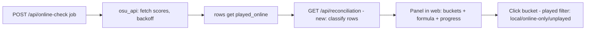

# Design — Unplayed count reconciliation

## Overview
Reuse the entire existing online-check pipeline. The only new server surface
is derived data (a single classification summary), and the only new UI is one
panel plus one extra played-filter state. Nothing about scanning, tokens or
the osu! API changes.

## Architecture

## Components and Interfaces

### Backend — `src/server.py`
- New endpoint `GET /api/reconciliation` →
  `{"available": bool, "linked": bool, "total": int, "local_played": int,
    "online_only": int, "unplayed": int, "lazer_style_unplayed": int,
    "checking": {"state": str, "checked": int, "total": int} | null}`
  - `available=false` when no library rows are loaded.
  - Classification per row: `played_local` → local_played; else
    `played_online` → online_only; else unplayed. `lazer_style_unplayed =
    unplayed + online_only` (lazer "by rank" treats online-played as played).
  - Reuses the existing jobs registry for `checking` progress — no new
    threading.
- No changes to `/api/online-check` itself.

### Frontend — `web/`
- `web/api.js`: `fetchReconciliation()`.
- `web/reconcile.js` (new module, no-build, same ES-module pattern): renders
  the panel into a `<dialog>`/section opened from the sidebar counts block.
  Shows the four numbers, the formula line
  (`lazer-style unplayed = unplayed + online-only`), and a live progress
  line when `checking` is present (polls `/api/jobs/{id}` like the scan bar).
- Bucket click → sets the played filter to `local` / `online_only` /
  `unplayed`. Requires extending the played filter (currently boolean
  `played_local || played_online` in `store.js isPlayed`) with a tri-state:
  `all | played | online_only | unplayed`. The filter option lives in the
  same prefs system (`LS_KEY`) so state survives reload; old prefs without
  the new field fall back to `all`.
- Panel highlight follows the active filter.

### Filter semantics (careful part)
- `isPlayed(m, mode)`: `all` → true; `played` → `played_local ||
  played_online` (current behavior); `online_only` → `!played_local &&
  played_online`; `unplayed` → `!played_local && !played_online`.
- Select-all/visible-count logic uses the filtered rows, so it inherits this
  automatically.

## Data Models
No persisted schema changes. Prefs gain `played_mode: string` (default
`"all"`). `/api/reconciliation` is computed on demand from in-memory rows.

## Error Handling
- Unlinked token: `linked:false`, panel shows a "link account first" CTA that
  opens the existing auth dialog.
- Online check never run: `online_only=0` shown with a "run online check"
  CTA (button POSTs `/api/online-check`).
- Corrupt rows (missing flags): treated as unplayed; the endpoint never 500s
  on individual rows.
- Job failure: panel shows the job's error state with a retry button
  (existing job error format).

## Testing Strategy
- `tests/test_reconciliation.py`: start server fixture, seed rows covering
  all three classes + corrupt row; assert endpoint math, `available`/
  `linked` gates, and lazer_style_unplayed.
- Filter tests in `tests/test_server.py`-style loopback tests: tri-state
  filter via `GET /api/library?played=...` (wire the param through
  `apply_filters`/`Filters`).
- Web: `node --check` via existing script; manual check of prefs fallback
  (old LS_KEY payloads → `all`).
- Panel progress reuses job polling; covered indirectly by the endpoint test.

## Requirement traceability
| Requirement | Component |
|---|---|
| 1 Classification | GET /api/reconciliation |
| 2 Panel + formula + progress | web/reconcile.js + jobs registry |
| 3 Drill-down | tri-state played filter + prefs |
| 4 Non-functional | unchanged osu_api backoff; tests |
